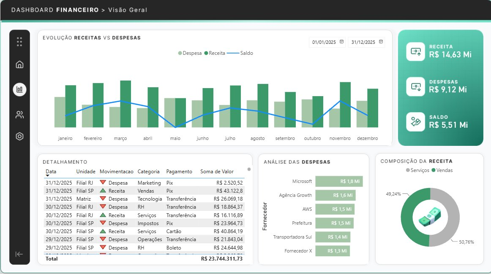
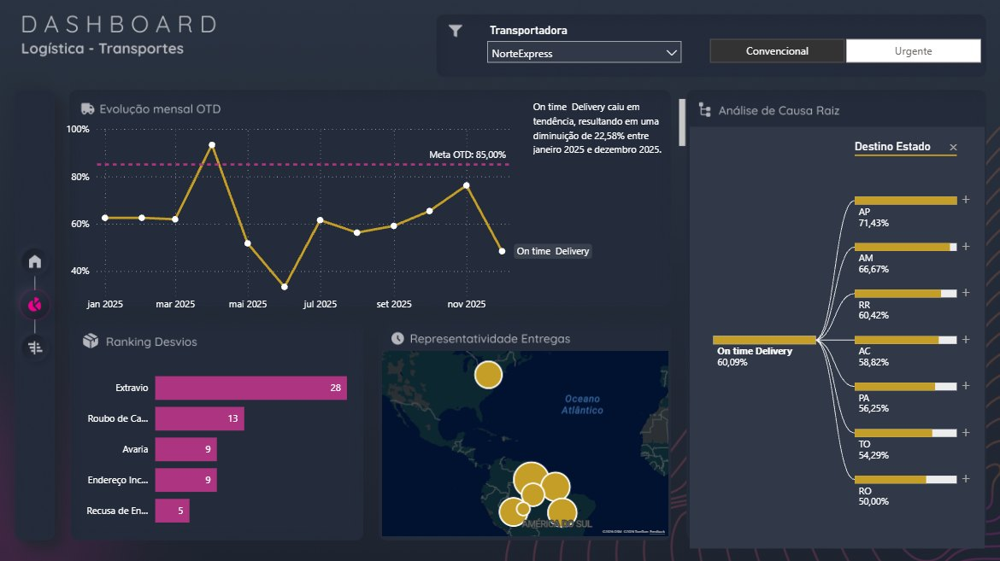

# Portfólio Power BI · Robson Pereira

Projetos de estudo em **Power BI** que desenvolvi na minha transição para a área de Análise de Dados. Cada pasta tem o print do painel e a explicação do problema, do que foi construído e dos principais resultados.

**Ferramentas:** Power BI · DAX · Power Query · Modelagem de dados · SQL Server · Python (Pandas) · Excel

| Projeto | Tema | Destaque |
| --- | --- | --- |
| [Dashboard Financeiro](./financeiro) | Receitas x despesas de uma empresa com matriz e filiais | Receita de R$ 14,63 mi, despesas de R$ 9,12 mi e saldo de R$ 5,51 mi em 2025 |
| [Dashboard de Logística](./logistica) | Prazo de entrega (OTD) de transportadoras | OTD caiu 22,58% em 2025 e ficou abaixo da meta de 85% em quase todos os meses |

---

## Dashboard Financeiro – Receitas x Despesas

## Dashboard de Logística – Transportes e Entregas

---

📍 Recife/PE · Em busca de vaga de Analista de Dados / BI Júnior
🔗 [LinkedIn](https://www.linkedin.com/in/robson-pereira-dados)
