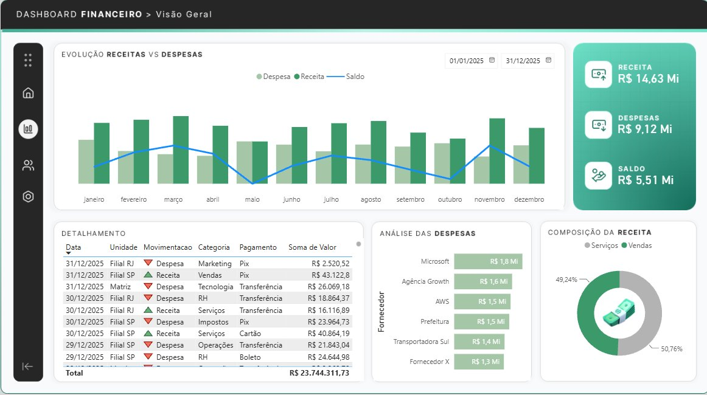

# Dashboard Financeiro – Receitas x Despesas

## Objetivo
Acompanhar a saúde financeira de uma empresa com matriz e filiais (RJ e SP) ao longo de 2025, mostrando de onde vem a receita, para onde vai a despesa e como o saldo evolui mês a mês.

## O que o painel mostra
- **KPIs do período:** Receita (R$ 14,63 mi), Despesas (R$ 9,12 mi) e Saldo (R$ 5,51 mi)
- **Evolução mensal** de receitas x despesas, com linha de saldo
- **Análise das despesas por fornecedor** (Microsoft, Agência Growth, AWS e outros)
- **Composição da receita:** serviços (49,24%) x vendas (50,76%)
- **Detalhamento** das movimentações por data, unidade, categoria e forma de pagamento
- Filtro de período e menu lateral para navegar entre as páginas

## Principais leituras
- O saldo ficou mais apertado em **maio** e **outubro**, quando receita e despesa praticamente se igualaram.
- Receita equilibrada entre serviços e vendas, sem dependência de uma única fonte.

## Ferramentas
Power BI · Power Query (tratamento dos dados) · DAX (medidas) · Modelagem de dados
