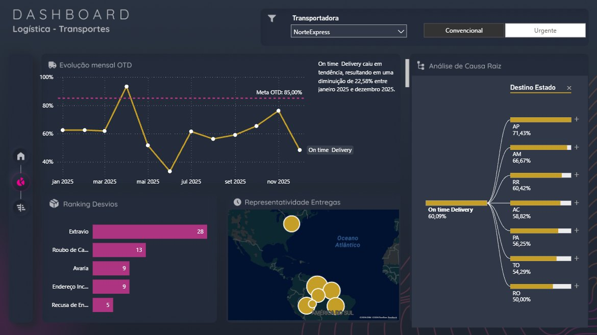

# Dashboard de Logística – Transportes e Entregas

## Objetivo
Monitorar o desempenho de entregas das transportadoras pelo indicador **OTD (On Time Delivery)** e identificar onde e por que as entregas atrasam.

## O que o painel mostra
- **Evolução mensal do OTD** comparada à meta de 85%, com texto de insight dinâmico
- **Análise de causa raiz** com árvore de decomposição por estado de destino
- **Ranking de desvios:** extravio, roubo de carga, avaria, endereço incorreto e recusa
- **Mapa** com a representatividade das entregas por região
- Filtros por **transportadora** e **tipo de entrega** (convencional x urgente)

## Principais leituras (transportadora NorteExpress, entrega convencional)
- O OTD **caiu 22,58%** entre janeiro e dezembro de 2025 e só superou a meta em um mês.
- **Extravio** é o principal desvio (28 ocorrências), seguido de roubo de carga (13).
- Estados com pior OTD: **RO (50%)**, **TO (54,29%)** e **PA (56,25%)**.

## Ferramentas
Power BI · Power Query · DAX · Modelagem de dados · Árvore de decomposição · Mapa
